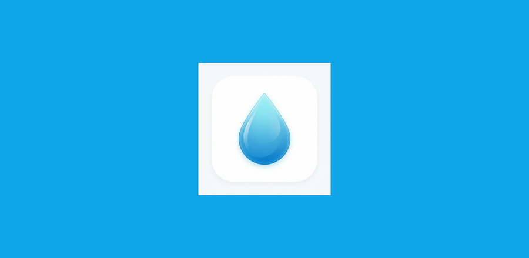
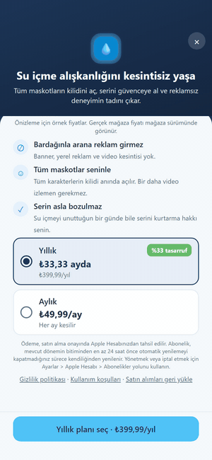
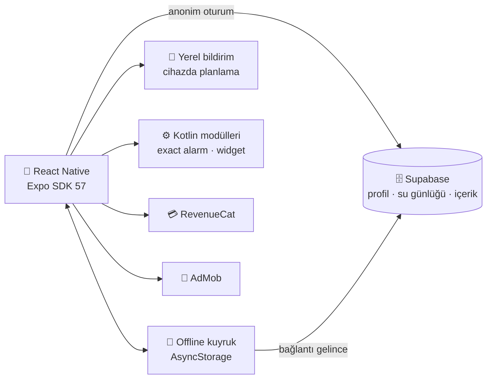

 

> 🔒 Kaynak kod private. Bu repo uygulamanın vitrini: özellikler, mimari ve çözülen teknik problemler. Mülakatlarda kod üzerinden anlatmaktan memnuniyet duyarım.

 

---

## 💡 Ne Yapar?

Kilo, boy, yaş, cinsiyet ve aktivite seviyene göre **günlük su hedefini hesaplar**, bardak/şişe ile eklediğin suyu takip eder ve seni seçtiğin **maskotun sesiyle** hatırlatır. 💧 Seriyi (streak) korursan Lumi mutlu, unutursan seni geri çağırır.

---

## ✨ Özellikler

| | Özellik | Ayrıntı |
|:-:|---|---|
| 🎯 | **Kişiye özel hedef** | Kilo, boy, yaş, cinsiyet ve aktiviteye göre önerilen günlük miktar |
| 🥤 | **Hızlı ekleme** | Animasyonlu su şişesi, yüzde ilerleme, bardak/şişe kartları |
| 🦊 | **18 maskot · 7 ruh hali** | SVG silüetler; ortak yüz motoru ilerlemeye göre ifade değiştirir |
| 🔔 | **Akıllı hatırlatma** | 08:00–22:00 arası otomatik aralık veya özel saat listesi; hedef dolunca günün kalanı susar |
| 🔥 | **Seri ve seri kalkanı** | Dün hedef kaçtıysa "serini koru" akışı |
| 📊 | **İstatistik** | Haftalık, aylık, yıllık grafikler |
| 💬 | **Motivasyon desteleri** | Dile göre sunucudan gelen günlük kartlar |
| 📱 | **Android widget** | Ana ekranda günlük ilerleme |
| 📴 | **Çevrimdışı çalışma** | İşlemler kuyruğa alınır, bağlantı gelince Supabase'e eşitlenir |
| 🌍 | **28 dil** | Birimler de yerelleştirilir (kg/cm/ml ve Kiril/Asya kısaltmaları) |
| 💎 | **Premium** | Reklamsız kullanım, tüm maskotlar, tek dokunuşla seri kalkanı |

---

## 🎬 Premium Ekranı

---

## 🏗️ Mimari

| Katman | Teknoloji |
|---|---|
| 📱 Uygulama | Expo SDK 57 · React Native 0.86 · React 19 · React Navigation |
| 🌍 Yerelleştirme | i18next · expo-localization · 28 dil |
| 🗄️ Backend | Supabase (anonim auth, PostgreSQL, SQL fonksiyonları) |
| 📴 Çevrimdışı | AsyncStorage kuyruk ve önbellek, artımlı/mutlak eşitleme modları |
| 🔔 Bildirim | expo-notifications (yalnızca yerel planlama, sunucu yok) |
| ⚙️ Native | Kotlin Expo Modules: tam zamanlı alarm, Android ana ekran widget'ı |
| 💳 Gelir | RevenueCat (Premium) · AdMob (ödüllü, geçiş, native, banner) |
| 🧪 Kalite | Jest (24 test dosyası) · ESLint · GitHub Actions CI |
| 🚀 Dağıtım | EAS Build · Expo config plugin'leri (R8, AdMob, bildirim ikonu) |

---

## 🧠 Çözülen Teknik Problemler

📴 <b>Çevrimdışıyken su eklemek ve veri kaybetmemek</b>

 

Bağlantı yokken yapılan su ve profil işlemleri AsyncStorage'daki bir kuyruğa yazılıyor. Çevrimdışına geçmeden önceki sunucu değeri saklanıyor; bağlantı gelince işlemler **artımlı** ya da **mutlak** modda Supabase'e eşitleniyor. Gece yarısında gün değişirse yeni gün kontrolüyle eski günün kaydı yanlış güne yazılmıyor.

🔔 <b>Sunucusuz ama bağlama duyarlı bildirim</b>

 

Hatırlatmalar tamamen cihazda planlanıyor; FCM veya sunucu cron'u yok. Metin, kullanıcının durumuna göre seçiliyor: seri riskteyse akşam uyarısı, öğleden sonra hâlâ 0 ml ise ayrı bir mesaj, seri koptuysa geri çağırma, 3/7/14/30. günlerde kutlama. Her metin seçili maskotun ağzından yazılıyor ve 28 dilde var.

⏰ <b>Android'in hatırlatmaları geciktirmesi</b>

 

Android pil optimizasyonu zamanlanmış bildirimleri kaydırabiliyor. Bunun için Kotlin ile yazılmış bir **Expo native modülü** tam zamanlı alarm iznini ve pil optimizasyonu durumunu kontrol ediyor, gerekirse kullanıcıyı ilgili sistem ayarına yönlendiriyor. Ayrı bir Kotlin modülü günlük ilerlemeyi ana ekran widget'ına yazıyor.

🌍 <b>28 dili bozmadan güncel tutmak</b>

 

Her dil ayrı bir JSON dosyası. CI'daki `check:locales` adımı eksik veya fazla anahtarı ve `{{placeholder}}` sapmalarını yakalayıp build'i kırıyor. Maskot ve ruh hali metin kuralları da ayrı bir kontrolle (`check:lumi`) denetleniyor.

💳 <b>Reklam ve abonelik dengesini korumak</b>

 

Geçiş reklamları sekme değişiminde, bekleme süresi (cooldown) ile gösteriliyor. Zamanlı paywall teklifi haftada en fazla bir kez çıkıyor. Seri kalkanı ile paywall aynı oturumda çakışırsa önce paywall açılıyor; satın alma olursa kalkan otomatik uygulanıyor. Bu kuralların hepsi Jest testleriyle korunuyor.

---

## 🌍 Diller

`tr` `en` `de` `es` `fr` `it` `pt` `nl` `pl` `ru` `uk` `cs` `ro` `sv` `nb` `ja` `ko` `zh` `zh-Hant` `id` `ms` `vi` `th` `hi` `bn` `te` `ta` `mr`

---

## 🔐 Gizlilik

📄 [Gizlilik politikası ve kullanım koşulları](https://github.com/mertglbyz/Water_Reminder_Support)

---

## 👨‍💻 Geliştirici

**Mert Gülbeyaz** — Mobile App Developer | AI/ML Engineer

